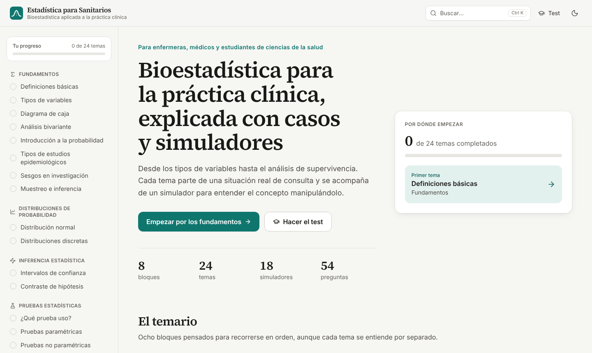

# Estadística para Sanitarios

Recurso docente abierto de bioestadística aplicada a la práctica clínica, para enfermeras, médicos y estudiantes de ciencias de la salud. Cada tema parte de un caso de consulta y se acompaña de un simulador interactivo.

[](https://github.com/adrian-ai-salud/EstadisticaParaSanitarios/actions/workflows/ci.yml)
[](https://doi.org/10.5281/zenodo.15874324)
[](https://creativecommons.org/licenses/by/4.0/deed.es)

**Abrir la aplicación:** https://adrianvencesgarrido.com/EstadisticaParaSanitarios/ (copia en [GitHub Pages](https://adrian-ai-salud.github.io/EstadisticaParaSanitarios/))



## Contenido

| Bloque | Temas |
|---|---|
| 1. Fundamentos | Definiciones básicas, tipos de variables, diagrama de caja, análisis bivariante, probabilidad, diseños de estudio, sesgos, muestreo |
| 2. Distribuciones | Normal, binomial y Poisson |
| 3. Inferencia | Intervalos de confianza, contraste de hipótesis y potencia |
| 4. Pruebas estadísticas | Asistente «¿Qué prueba uso?», pruebas paramétricas y no paramétricas |
| 5. Modelos predictivos | Regresión lineal simple y múltiple, modelos de clasificación |
| 6. Supervivencia | Censura, Kaplan-Meier y log-rank, modelo de Cox |
| 7. Series temporales | Componentes, estacionariedad y ARIMA |
| 8. Pruebas diagnósticas | Sensibilidad, especificidad, valores predictivos y razones de verosimilitud |

Incluye un test de autoevaluación de 54 preguntas con explicaciones, buscador, modo oscuro y seguimiento del progreso.

## Finalidad y limitaciones

Es material educativo. Los simuladores usan datos sintéticos y no sustituyen al software estadístico ni al asesoramiento metodológico; la calculadora de pruebas diagnósticas no está pensada para decidir sobre pacientes concretos. Detalle en [docs/finalidad-prevista.md](docs/finalidad-prevista.md).

## Privacidad

Todo funciona en el navegador. No hay servidor, cuentas, cookies, analítica ni recursos de terceros. El progreso y el tema de color se guardan solo en el almacenamiento local del navegador.

## Desarrollo

Requiere Node.js 22 o superior.

```bash
npm install
npm run dev        # servidor local en http://localhost:3000/EstadisticaParaSanitarios
npm test           # pruebas de las funciones estadísticas
npm run lint       # formato y estilo (Biome)
npm run build      # exportación estática en out/
```

Los textos de cada tema están en `src/content/<bloque>/<tema>.mdx` y se pueden editar como Markdown. El índice del temario está en `src/content/temario.ts`, las funciones estadísticas en `src/lib/stats/` y los simuladores en `src/components/sim/`.

Cada cambio en la rama `master` se publica automáticamente en GitHub Pages.

### Publicar en adrianvencesgarrido.com

`npm run build` genera la web estática en `out/`. Su contenido se sube por FTP a la carpeta `EstadisticaParaSanitarios` del servidor, sustituyendo la versión anterior. La ruta base `/EstadisticaParaSanitarios` está fijada en `next.config.ts`.

## Cómo citar

Usa el botón «Cite this repository» de GitHub o los datos de [CITATION.cff](CITATION.cff):

> Vences Garrido A. Estadística para Sanitarios [Internet]. Zenodo; 2025. doi:10.5281/zenodo.15874324

## Licencia y autoría

Contenidos docentes bajo licencia [CC BY 4.0](https://creativecommons.org/licenses/by/4.0/deed.es). Código bajo licencia MIT ([LICENSE](LICENSE)).

Adrián Vences Garrido, enfermero especialista en Enfermería Familiar y Comunitaria · [ORCID 0009-0001-2460-9318](https://orcid.org/0009-0001-2460-9318) · [adrianvencesgarrido.com](https://adrianvencesgarrido.com)
